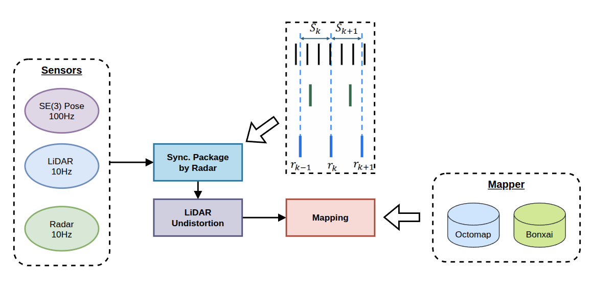
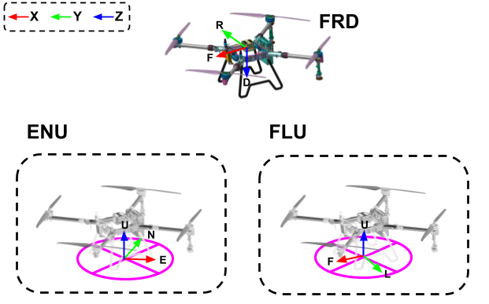
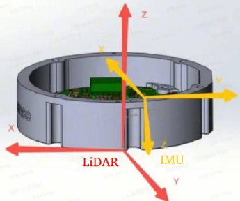
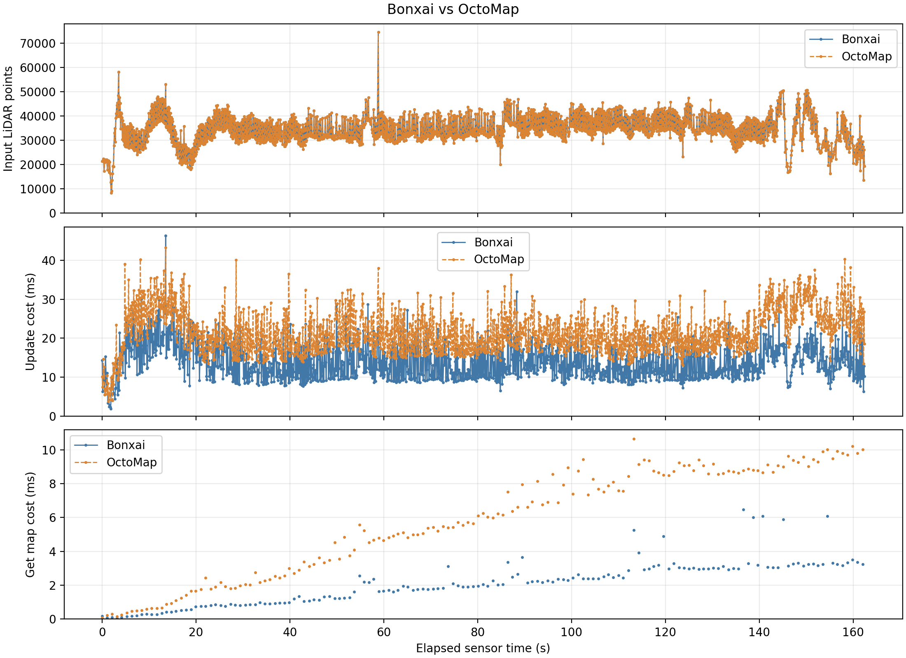
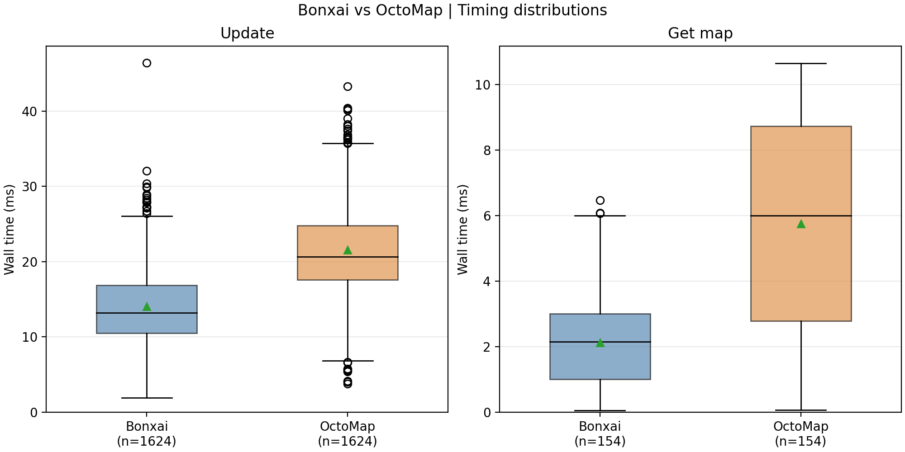

# AgriLiRa4D_Mapping

***Mapping package for "AgriLiRa4D: A Multi-Sensor UAV Dataset for Robust SLAM in Challenging Agricultural Fields".***



**Supported Platforms**

- ROS-Noetic on Ubuntu20.04
<!-- - ROS-One on Ubuntu22.04 -->

## Third-party

- PCL
- Eigen3
- Octomap

## Run

```bash
# build
mkdir -p ws_agrilira4d/src
cd ws_agrilira4d/src
git clone git@github.com:zhan994/AgriLiRa4D_Mapping.git
cd ..
catkin_make

# run
source devel/setup.bash
roslaunch mapping mapping.launch
```


## Notes

**Ground-Truth Odometry for FRD (Body) in FLU**



**Extrinsics for Robosense Airy LiDAR**




## Map output

The latched `/map_cloud` topic publishes occupied voxel centers as `sensor_msgs/PointCloud2` in the `world` frame. 
Publication follows `mapper.publish_period`. 
Merged OctoMap leaves are enumerated at `mapper.resolution`, so every point represents one base-resolution voxel.
RViz's Map Cloud display uses 0.5 m boxes by default; adjust its Size (m) when changing the configured resolution.

`Mapper::GetOccupiedCloud()` replaces its output with this occupied cloud.
`Mapper::Save(path)` writes the same points as a binary PCD file; use a `.pcd` extension. 
This export stores occupied geometry, without free-space or probability state.

## Bonxai backend

Set `mapper.type: 1` to use Bonxai (`0` selects OctoMap). 
Both backends use `Mapper::Options`, configured directly under `mapper`: `resolution`, `max_range`, `hit_prob`, `miss_prob`, and `occupancy_threshold`. 
Switching backends only requires changing `mapper.type`. 
Bonxai uses the bundled headers in `thirdparty/bonxai`; no external Bonxai checkout is required. Both backends publish `/map_cloud` and save binary PCD files.

The Bonxai backend traces each valid LiDAR return to its actual endpoint using 3D DDA, excludes the endpoint from free-space carving, and only marks endpoints strictly inside `max_range` as hits. 
Each voxel receives one update per input, with hits taking precedence. 
Float log-odds and the default OctoMap probability clamps (0.1192 and 0.971) are used. 
Radar data is currently not integrated.

## Mapping timing CSV and plots

`mapper.timing_csv` sets the CSV output path (empty string disables recording).
Each run overwrites the selected file; use different paths to retain OctoMap and Bonxai runs. 
Relative paths use the node's working directory.

Each mapping update writes and flushes one row:

```csv
timestamp,data_size,update_cost,get_map_cost
1710000000.100000000,15000,12.450000,2.300000
1710000000.200000000,14200,11.800000,
```

- `timestamp`: synchronized input timestamp, in seconds.
- `data_size`: number of input LiDAR points passed to `Update()`; not bytes or
  output map points. Radar currently does not participate in map updates.
- `update_cost`: wall time of `Mapper::Update()`, in milliseconds.
- `get_map_cost`: wall time of `GetOccupiedCloud()`, in milliseconds, excluding
  ROS message conversion, publication and CSV I/O. This column is blank when
  `mapper.publish_period` skips map extraction. Set `publish_period: 0` to
  measure extraction on every update (this adds a full map traversal each time).

With Python 3 and Matplotlib installed, run:

```bash
python3 scripts/plot_mapper_timing.py /tmp/agrilira4d_mapper_timing.csv
# Optional output directory, vector format and interactive display:
python3 scripts/plot_mapper_timing.py /tmp/agrilira4d_mapper_timing.csv --output-dir plots --format pdf --show
```






The script saves `*_timeseries.png` (input point count, update cost and extraction cost against elapsed sensor time) and `*_boxplot.png` (both timing distributions).
Blank extraction samples are excluded from the distributions. 
Boxes show the interquartile range and median, whiskers use 1.5 IQR, triangles mark means, and outliers remain visible. 
Sample counts, mean, median and nearest-rank p95 are also printed. 
The default mode works without a display; `--format` supports PNG, PDF and SVG.

Compare two runs using the same script:

```bash
python3 scripts/plot_mapper_timing.py octomap.csv bonxai.csv --labels OctoMap Bonxai --output-dir plots
```

The three time-series panels overlay both schemes using consistent colors and line styles. 
The boxplot figure groups schemes separately for update and map extraction costs, with sample counts on the labels. 
Statistics are printed per scheme and metric; missing extraction samples are excluded. 
Output names are `octomap_vs_bonxai_timeseries.png` and `octomap_vs_bonxai_boxplot.png`. 
Single-CSV usage is also supported. Labels default to each CSV filename stem.

Each run starts at elapsed time zero by default; use `--time-axis timestamp` to compare original sensor timestamps, for example if the runs cover different portions of the same recording. 
Samples are not interpolated or paired, and each boxplot includes all available samples from its run. 
Use the same dataset slice and `mapper.publish_period` for comparable workloads and extraction sampling.
